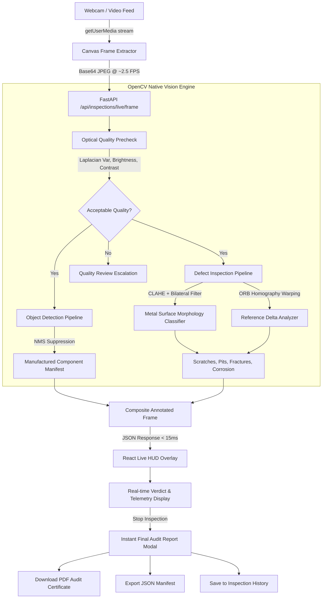

# NETRADRISHTI — Agentic Vision Inspection System

> **Industrial-grade Real-Time Quality Assurance & Defect Localization Platform powered by OpenCV & FastAPI.**

[](https://opencv.org/)
[](https://fastapi.tiangolo.com/)
[](https://react.dev/)
[](#integration-testing)

---

## Overview

**NETRADRISHTI** (नेत्रदृष्टि — *The Vision Eye*) is a full-stack, autonomous vision inspection platform engineered for high-throughput industrial manufacturing lines. It pairs a **Python 3 / OpenCV 5.0** native computer-vision backend with a **React 19 + TypeScript** frontend designed in an executive British Racing Green & Warm Ivory aesthetic.

The system delivers:
- **Continuous Live Camera Inspection**: Real-time video frame processing (~2.5 FPS) with sequence synchronization, latency monitoring, and zero UI stutter.
- **Multi-Class Industrial Object Detection**: Multi-scale contour and morphology detector with Non-Maximum Suppression (NMS) to localize containers, machined parts, PCBs, SMT chips, textiles, and fasteners.
- **Metal Surface Anomaly Analysis**: CLAHE glare suppression, bilateral smoothing, and morphological classification of scratches, pitting voids, fractures, and corrosion.
- **Reference-Based Differential Inspection**: ORB feature extraction and RANSAC homography warping for sub-pixel comparison against golden reference masters.
- **Instant Detailed Inspection Reports**: On session completion, generates side-by-side evidence, defect manifests, optical clarity metrics, direct PDF download (`jsPDF`), structured JSON export, and persistent history storage.

---

## Architecture



---

## Key Features

### 1. Continuous Live Video Inspection
- **True Continuous Stream**: Processes frames sequentially without tearing down the camera feed or freezing the UI.
- **Concurrency & Sequence Protection**: Monotonic sequence tracking (`frameSeqRef`) prevents out-of-order frame delivery over the network.
- **Real-Time HUD Overlay**: Canvas overlays dynamically scale to native video resolution, drawing category-coded bounding boxes for objects (amber/teal) and defects (crimson/amber).
- **Honest Telemetry**: No fabricated values. Real-time metrics show actual Laplacian blur variance, RMS contrast, measured latency (ms), and actual frame rate.

### 2. Multi-Class Object Detection
Localizes and classifies components using multi-scale geometric invariants and HSV color profiling:
- **Glass / PET Containers (`bottle`)**: Aspect ratio $> 1.3$ with neck profile analysis.
- **Machined Metal Flanges / Discs (`metal_part`)**: High circularity and disc contour matching.
- **Square Metal Plates / Brackets (`metal_part`)**: Square solidity $> 0.85$ and aspect ratio $< 1.1$.
- **PCB Assemblies (`pcb`)**: Green solder mask HSV segmentation with dual dimension $> 120\text{px}$.
- **Microcontrollers & SMT Components (`electronic_chip`)**: Compact integrated circuit footprints.
- **Textile Inspection Swatches (`fabric_sample`)**: Textural aspect ratio classification.
- **Precision Fasteners (`fastener`)**: Hex head, bolt, and washer contours.

### 3. Industrial Metal Surface Pipeline
- **Specular Glare Suppression**: Contrast-Limited Adaptive Histogram Equalization (CLAHE) dampens specular reflections from stainless steel and aluminum.
- **Surface Scratches & Gouges**: Identified by elongated contours (aspect ratio $\ge 2.8$).
- **Pitting & Porosity Voids**: Identified by compact circular craters (circularity $\ge 0.55$, area $\le 450\text{ px}^2$).
- **Fracture & Material Voids**: Substantial structural cracks (area $> 220\text{ px}^2$).
- **Corrosion & Rust Oxidation**: HSV chromatic range segmentation ($\text{Hue } 8\text{--}28, \text{Sat } 60\text{--}240, \text{Val } 40\text{--}220$).

### 4. Comprehensive Reporting
- **Instant Full-Screen Modal**: Automatically generated upon stopping an inspection session.
- **Dual Visual Evidence**: Shows original workpiece frame side-by-side with the OpenCV annotated frame.
- **Defect Manifest**: Lists every localized defect with coordinates, surface area ($\text{px}^2$), severity, and diagnostic description.
- **Direct PDF Export**: Generates a professional multi-page industrial certificate via `jsPDF`.
- **JSON Export & History Storage**: Persisted locally and on the backend (`backend/data/inspections.json`).

---

## Getting Started

### Prerequisites
- **Node.js**: v18.0.0 or higher
- **Python**: 3.9 or higher
- **Webcam**: Integrated or USB camera for live streaming

### 1. Installation

Clone the repository and install dependencies:

```bash
# Clone the repository
git clone <repo-url>
cd "open cv"

# Install frontend dependencies
npm install

# Setup Python virtual environment & backend dependencies
cd backend
python3 -m venv venv
source venv/bin/activate
pip install -r requirements.txt
cd ..
```

### 2. Running Locally

Start the backend and frontend development servers:

#### Terminal 1 — FastAPI Backend (Port 8000)
```bash
cd backend
source venv/bin/activate
uvicorn main:app --host 127.0.0.1 --port 8000 --reload
```
*Health Check*: [http://127.0.0.1:8000/api/health](http://127.0.0.1:8000/api/health)  
*Interactive Docs*: [http://127.0.0.1:8000/docs](http://127.0.0.1:8000/docs)

#### Terminal 2 — Vite React Frontend (Port 5173)
```bash
npm run dev
```
*Application URL*: [http://localhost:5173](http://localhost:5173)

---

## Integration Testing

The backend includes a comprehensive 11-step integration test suite verifying health, anomaly detection, live frame streaming, reference alignment, persistence, and dataset serving:

```bash
cd backend
source venv/bin/activate
python3 test_suite.py
```

Expected output:
```
=======================================================
[TEST 1] Verifying Backend Health Check Endpoint... PASS
[TEST 2] Verifying Clean/Normal Sample Inspection... PASS
[TEST 3] Verifying Defect Sample Detection... PASS
[TEST 4] Verifying Low-Quality Precheck Escalation... PASS
[TEST 5] Verifying Real-time Live Camera Frame Pipeline... PASS (6ms)
[TEST 6] Verifying Reference-based Live Frame Comparison... PASS
[TEST 7] Verifying Live Session Disk Persistence... PASS
[TEST 8] Verifying Metal Surface Inspection Pipeline... PASS
[TEST 9] Verifying Object Detection Pipeline... PASS (1ms)
[TEST 10] Verifying Datasets API & Sample Asset Serving... PASS
[TEST 11] Verifying Continuous Live Frame Pipeline with Objects & Defects... PASS (2ms)
=======================================================
ALL 11 BACKEND INTEGRATION TESTS PASSED SUCCESSFULLY!
```

---

## API Reference

| Endpoint | Method | Description |
| :--- | :--- | :--- |
| `/api/health` | `GET` | System health check and OpenCV capability status. |
| `/api/inspections/live/frame` | `POST` | High-throughput live streaming analysis ($< 15\text{ ms}$). Returns objects, defects, quality, and annotated frame. |
| `/inspect` | `POST` | Deep single-image inspection with full tool execution trace. |
| `/api/detect/objects` | `POST` | Dedicated multi-scale object detection with NMS bounding boxes. |
| `/api/inspections/save` | `POST` | Persists a completed live inspection session to disk. |
| `/api/inspections` | `GET` | Fetches historical inspection sessions stored on disk. |
| `/api/datasets` | `GET` | Benchmark dataset suites (MVTec AD, Metal Surface, PCB, Fabric). |

---

## Technology Stack

- **Computer Vision Core**: OpenCV 5.0 (Python), NumPy, SciPy
- **Backend API**: FastAPI, Uvicorn, Pydantic
- **Frontend Framework**: React 19, TypeScript, Vite
- **UI & Visualization**: Lucide Icons, Canvas 2D API, Three.js (Landing Scene)
- **Reporting Engine**: jsPDF, html2canvas, Canvas Blob Exporter
- **State Management**: Zustand, React Router 7

---

## License

This project is proprietary and confidential — developed for advanced industrial vision inspection.
# NETRADRISHTI
